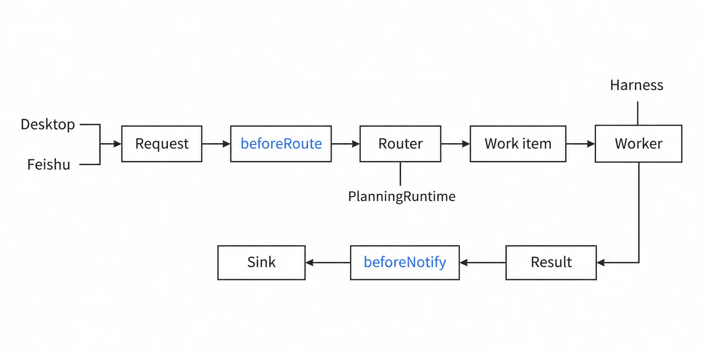
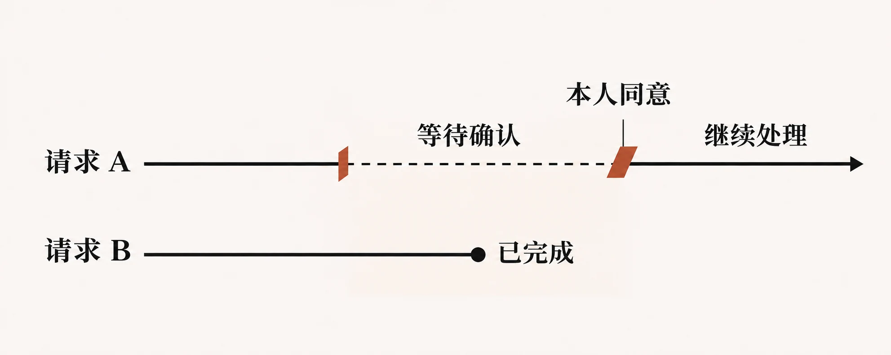
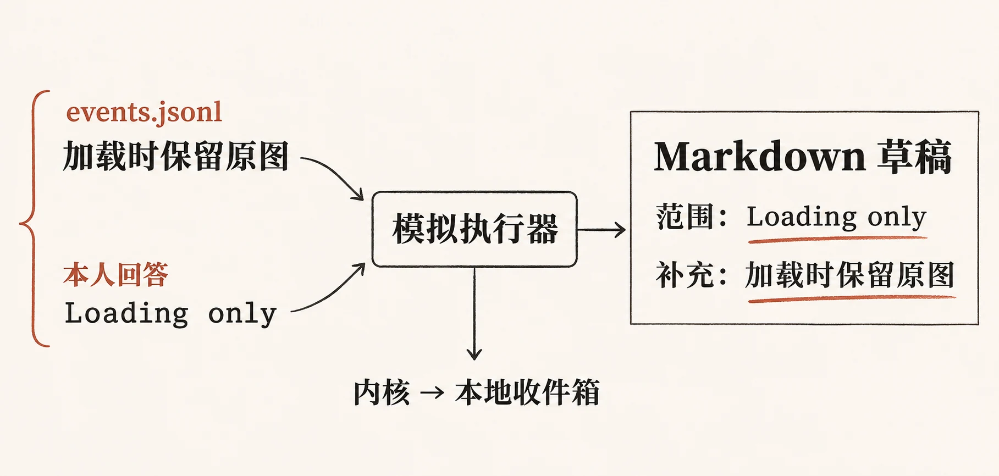

# Work Agent Kernel

[简体中文](README.md) · **English**

> Yesterday you drafted a release checklist in Codex Desktop. Today a teammate writes in Feishu, “Add the rollback steps, too.” Which chat has the draft?

Work Agent Kernel is a local TypeScript framework that gives ongoing work a durable **work item**. Requests can arrive through different channels. When the router recognizes a follow-up, the kernel attaches it to the original item and gives the worker its previous session ID. The default app connects Feishu and Codex. Its Desktop plugin lets you browse project sessions and trace a routing decision back to the message that prompted it.

[Try the offline demo](#quick-start) · [Explore extension points](#extend-the-framework) · [Inspect a generated draft](#how-does-an-external-plugin-run-the-whole-loop)

## How does a follow-up find the right session?



Consider the release checklist. Desktop supplies the goal you typed. The Feishu adapter supplies the incoming message and the project bound to its chat. Once admitted, both requests reach the same **router**. It can look up existing work and propose attaching the follow-up to the checklist. A casual message can simply stay in the inbox.

The **kernel** checks the project, target item, and permissions, then records the decision in SQLite. The **worker** receives the task and the stored session ID and resumes that chat. The work item owns the goal, inputs, and results. The executor owns the meaning of its session ID. If you explicitly switch executors later, the new one can use the item's history and start its own session. [Routing and session design](docs/architecture/routing.md)

## Quick start

### Watch a worker resume its session

With **Node.js 24**, run these commands from the repository root:

```sh
npm ci --ignore-scripts
npm run demo
```

The demo uses a temporary SQLite database, synthetic messages, and simulated workers. No account or API key is required. A colleague asks whether a comparison card can show a loading state, then narrows the scope to mobile. The worker asks whether to include the failure state. The demo restarts the kernel, supplies the user's answer, and attaches a design comment to the same item.

| Look for this output | What it demonstrates |
| --- | --- |
| `workItems: 1`, `events: 3` | Three inputs contributed to one work item. |
| `sameSessionAfterAnswer: true` | The worker resumed its original session after the user answered. |
| `harnessAfterRebind: "echo"` | The final step switched workers and kept the work item and its earlier results. |

### Bring your own project to Codex Desktop

Use a macOS version of Codex Desktop that supports MCP Apps and a signed-in Codex CLI. After installing the root dependencies above, run:

```sh
npm --prefix plugins/router-inbox ci
npm --prefix plugins/router-inbox run install:codex
node src/router/cli.ts serve
```

Leave the service running. In the plugin, open **项目会话 (Project sessions) → ＋ 新建项目 (New project)**. Enter a name and an existing local working directory. Add a Codex chat you already use, or submit a task from the overview menu. Click a session to open its native chat. For sessions with routing records, **查看流程 (View trace)** shows how a message got there.

The default router and worker inherit your local Codex model and reasoning settings. To receive Feishu messages, connect an event producer to the inbox. Reading chat history and sending approval cards require the corresponding Feishu permissions. The linked guides are in Chinese. [Plugin installation and removal](plugins/router-inbox/README.md) · [Feishu and inbox setup](docs/ROUTER.md)

## When should sending a card pause the work?



Ask whether the next step needs an answer. When a message arrives from an unbound chat and admission checks are enabled, the hook returns `wait`. The framework saves a checkpoint and the Feishu adapter sends a card. Delivery leaves that request waiting for your decision. Other requests can finish in the meantime.

Approve the request and the hook returns `continue`, optionally carrying context for the next step. Decline it and `break` ends this request. A completion notice can be queued in the background while the workflow continues. Run `node examples/lifecycle/demo.ts` to watch one request wait, another finish, and the first resume with the selected version. [Hook states and callback examples](docs/extensions/hooks.md)

To give the router your team’s checklist version, put this hook in a local module such as `business-hooks.mjs`:

```js
export function createHooks() {
  return [{
    id: 'team.checklist',
    phase: 'beforeRoute',
    run() { return { kind: 'continue', context: { checklistVersion: 'v2' } }; }
  }];
}
```

Set `ROUTER_HOOKS_FILE` to the absolute path of this trusted module before starting the service. The framework invokes it at `beforeRoute`, stores the version under the hook ID, and continues to the router. Register delivery rules at `beforeNotify`, after the work result has been saved.

## How does an external plugin run the whole loop?



The `demo:loop` example connects a team's own input, worker, and inbox to the kernel. The CLI loads a local module with `--plugins` and calls its `createPlugins()` factory. The module returns four implementations. [Plugin source](examples/offline-loop/plugin.ts)

| Plugin registration | What actually happens in the demo |
| --- | --- |
| `sources` → `FileEventSource` | Reads requests, revisions, and follow-ups from `events.jsonl`. The kernel deduplicates a replay of the same revision by its event key. |
| `router` → `fixtureRouter` | Makes a predetermined routing decision so the example is reproducible offline. |
| `harnesses` → `DurableDemoHarness` | Asks a scope question. Once answered, it writes a Markdown draft using the accumulated inputs and the selected scope. |
| `sinks` → `SqliteInbox` | Receives the question and final result notifications in a local SQLite inbox. |

The user's decision also comes through a public interface. The demo invokes `answer` in a separate CLI process and selects `Loading only`. Here the worker has already started and needs a decision. The admission card described above acts earlier, before routing.

On macOS or Linux, run the loop and open its output:

```sh
demo_dir=$(mktemp -d)
npm run demo:loop -- --directory "$demo_dir"
cat "$demo_dir"/drafts/*.md
```

The draft contains both `Chosen scope: Loading only` and the follow-up received while waiting, `Please keep the existing image while loading`. You can trace each line back to the input or decision that produced it. The example runs a simulated worker and keeps its messages and files in the temporary directory. [Demo script](examples/offline-loop/demo.ts)

## Extend the framework

| What you want to change | Where to start |
| --- | --- |
| Add a message channel or replace the tool that does the work | Implement a `Source` or `Harness` in `src/adapters/` and register it at startup. [Adapter contracts](docs/extensions/contracts.md) |
| Require approval or send an extra result notification | Add a `LifecycleHook` in `src/hooks/` before routing or notification. [Feishu admission example](src/hooks/feishu/admission.ts) |
| Change the planning model or supply external context | Implement `PlanningRuntime` or `ContextReader`. The Codex planner and the Codex worker can be replaced independently. [Planning contracts](src/core/planning/contracts.ts) |
| Assemble your own application | Pass the planning runtime, context reader, workers, and notification sinks to `createRouterApplication`. [Default app wiring](src/router/service.ts) |

[Testing](docs/TESTING.md) · [Contributing](CONTRIBUTING.md) · [MIT license](LICENSE)
