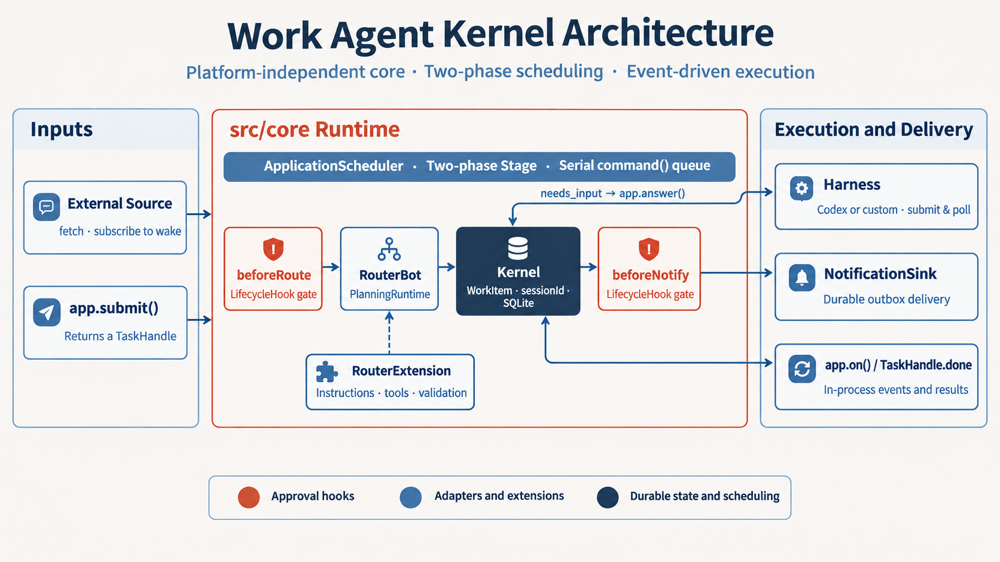

# Work Agent Kernel

**English** · [简体中文](README.zh-CN.md)

Work Agent Kernel is a **type-safe, crash-recoverable TypeScript framework for building a Router Bot**. It accepts requests from external channels and from callers submitting tasks directly. A planning model decides whether to create a work item, continue an existing session, or answer immediately. The kernel validates and commits the plan, dispatches work asynchronously, and tracks approvals, worker questions, and notification delivery.

`Node.js 24.x` · `TypeScript` · `ESM` · `SQLite WAL` · `MIT License`

[Quick start](#quick-start) · [Architecture](#architecture) · [Package entry points and extensions](#package-entry-points-and-extensions) · [Examples](#examples) · [Development and verification](#development-and-verification)

## Design guarantees

- **Separate planning and execution.** The Router produces a structured plan using read-only tools. A harness executes the work. Each work item retains its worker’s `sessionId` so follow-ups can resume the same conversation.
- **Validate decisions against evidence.** The Router can cite only evidence it received or read during the current request. Before continuing a work item, it must identify a visible candidate in the correct project. The kernel enforces action and tool-call budgets.
- **Recover interrupted work.** The scheduler separates slow external I/O from the synchronous commit that changes application state. On restart, the kernel uses the original `requestId` to look up an interrupted submission and polls accepted runs. An unconfirmed receipt stays unresolved rather than triggering a duplicate submission.
- **Pause one request at a time.** An approval hook can return `wait`; a worker can return `needs_input`. Other work can proceed while the application waits for a reply.
- **Keep platform dependencies explicit.** Core has no dependency on a platform adapter or example application. Compiler-based tests check that each adapter depends only on its own implementation and Core.

## Quick start

### 1. Submit a task in TypeScript

Create an application, start its scheduler, and submit a request. The following example uses a fixed planner and a simulated worker so the two stages are easy to see. A `TaskHandle` exposes a promise for each stage; applications can also subscribe to work events.

```ts
import { mkdirSync } from 'node:fs';
import {
  createRouterApplication,
  type Harness,
  type NotificationSink,
  type PlanningRuntime,
} from 'work-agent-kernel';

// 1. Define the planner. This example returns a fixed plan.
const runtime: PlanningRuntime = async (_request, _tools, _signal, _instructions) => ({
  answer: 'Created a build investigation',
  evidence: [],
  actions: [{ goal: 'Investigate today’s CI build failure', project: null, workId: null, evidence: [] }],
});

// 2. Provide a worker and a notification sink.
const worker: Harness = {
  async submit(req) {
    return { sessionId: 'sess-1', runId: `run-${req.requestId}` };
  },
  async lookup() {
    return null;
  },
  async poll() {
    return { kind: 'ready', summary: 'Found a dependency version conflict', evidence: ['log://ci/42'] };
  },
};

const inbox: NotificationSink = {
  async deliver(notice) {
    console.log('Worker report:', notice.body);
    return `receipt-${notice.id}`;
  },
};

// 3. Create the data directory and assemble the application.
const directory = './.agent-data';
mkdirSync(directory, { recursive: true });

const controller = new AbortController();
const app = createRouterApplication({
  directory,
  catalog: { defaultHarness: 'worker', projects: [] },
  runtime,
  harnesses: { worker },
  sinks: { inbox },
  signal: controller.signal,
});

// For this demo, answer worker questions by selecting the first option.
const off = app.on('work.needs_input', async ({ attention }) => {
  if (attention) {
    await app.answer({
      attentionId: attention.id,
      choice: attention.options[0]!,
      actor: 'local-owner',
    });
  }
});

app.start();

try {
  // 4. Submit a task and await both routing and execution.
  const task = app.submit({
    id: crypto.randomUUID(),
    description: 'Investigate today’s CI build failure',
    sources: [],
  });

  const plan = await task.routed;  // The committed plan, including result and workIds
  const result = await task.done;  // The execution outcomes for this submission
  console.log(plan.workIds, result.outcomes);
} finally {
  off();
  await app.stop();
  await app.close();
}
```

### 2. Run the offline demo

With **Node.js 24**, run the following from the repository root. The demo uses a temporary SQLite database and simulated adapters, so no account or API key is required.

```sh
npm ci --ignore-scripts
npm run build
npm run demo
```

The demo attaches a follow-up to an existing item, pauses for a worker question, reopens the kernel, and answers in the original session. It then explicitly switches the item to another harness with `rebind`.

| Output | What it verifies |
| --- | --- |
| `workItems: 1`, `events: 3` | Three inputs contributed to one continuing work item. |
| `sameSessionAfterAnswer: true` | The worker resumed its original session after recovery and the user’s answer. |
| `harnessAfterRebind: "echo"` | The final step switched workers while preserving earlier inputs and results. |

## Architecture



### How a request moves through the system

1. **Receive the request — `Source` or `app.submit()`.** A source supplies events through `fetch` and can wake the scheduler through `subscribe`. The kernel deduplicates events by `[source, externalId, revision]`. A direct submission enters the dispatch queue and immediately returns a `TaskHandle`.
2. **Check admission — `beforeRoute`.** A lifecycle hook can require approval, for example when a message arrives from an unregistered Feishu group. Returning `wait` records a checkpoint. A queued `HookEffect` delivers the approval request, and `app.resume(ticket, resolution)` resumes the workflow after the callback.
3. **Plan — `RouterBot` and `RouterExtension`.** Extensions can supply instructions, read-only tools, and a final `verify` check for this request. The `PlanningRuntime` returns a structured report containing its answer, actions, and evidence.
4. **Commit — `Kernel` and `ApplicationScheduler`.** The scheduler serializes state transitions. The kernel creates a `WorkItem` or appends to an existing item’s `pendingInputs`, records the routing decision, and links the source thread to the work.
5. **Execute — `Harness`.** Within its concurrency limit, the host calls `submit(request)` and records the receipt. The worker can report `ready`, `failed`, `reroute`, or `needs_input`. The last outcome creates an `Attention`; an authorized `app.answer()` lets the worker continue in the same session.
6. **Deliver and observe — `NotificationSink` and `app.on()`.** Durable notifications pass through `beforeNotify` and the outbox. The sink receives a stable notification ID for idempotent delivery. In-process clients can await the task handle or subscribe to `work.completed`, `work.failed`, and `work.needs_input`.

[Application lifecycle](docs/application.md) · [Architecture overview](docs/architecture/overview.md) · [Routing and sessions](docs/architecture/routing.md) · [Design decisions](docs/architecture/decisions.md)

## Package entry points and extensions

### Public imports

Running `npm run build` produces ESM modules and TypeScript declarations. The package exposes these entry points through `package.json` exports:

| Import path | What it provides |
| --- | --- |
| `work-agent-kernel` | `createRouterApplication`, `ApplicationStoppedError`, and public application and domain types |
| `work-agent-kernel/adapters/codex` | `codexPlanner` for routing and `CodexHarness` for execution through Codex App Server |
| `work-agent-kernel/adapters/feishu` | `RouterInbox`, chat and message-context readers, admission and notification hooks |
| `work-agent-kernel/adapters/responses` | A lightweight Responses API router with decision validation |
| `work-agent-kernel/adapters/file` | `FileEventSource` for JSONL input |
| `work-agent-kernel/adapters/local` | `SqliteInbox` for local notification delivery |

### Extend an application

| To… | Implement or configure | Reference |
| --- | --- | --- |
| Receive requests from another channel | A `Source` with `fetch` and an optional `subscribe` callback | [Extension contracts](docs/extensions/contracts.md) |
| Require approval or intercept a notification | A `LifecycleHook` at `beforeRoute` or `beforeNotify` | [Hook decisions and callbacks](docs/extensions/hooks.md) · [Feishu admission hook](src/adapters/feishu/hooks/admission.ts) |
| Give the Router business rules or tools | A `RouterExtension` registered in `router.extensions` | [Release-plan tool example](examples/feishu-codex/release-plan.ts) |
| Change the planning model | A `PlanningRuntime` passed as `options.runtime` | [Planner contract](src/core/planning/contracts.ts) |
| Connect another worker | A `Harness` implementing `submit`, `lookup`, and `poll` | [Codex harness](src/adapters/codex/harness.ts) |
| Choose the components used by a deployment | Assemble them with `createRouterApplication(options)` | [Feishu + Codex profile](examples/feishu-codex/profile.ts) |

## Examples

The [example directory guide](examples/README.md) separates complete applications from lower-level kernel demonstrations.

- **Feishu + Codex workbench (recommended).** The example combines group admission cards, per-project working directories and session history, direct task submission, and a [Codex Desktop plugin](plugins/router-inbox/README.md). In a supported macOS Codex Desktop environment, build the kernel as above, then install and start the example:

  ```sh
  npm --prefix plugins/router-inbox ci
  npm --prefix plugins/router-inbox run install:codex
  node examples/feishu-codex/cli.ts serve
  ```

  [Example guide](examples/feishu-codex/README.md) · [Quick start](examples/feishu-codex/QUICKSTART.md)

- **Wait for approval and resume.** Request B finishes while request A waits for external approval. When the approval arrives, A resumes from its checkpoint with the new context. [Lifecycle demo](examples/lifecycle/demo.ts) · [Hook guide](docs/extensions/hooks.md)
- **End-to-end external plugin.** The demo uses `FileEventSource` and `SqliteInbox` to submit a human answer from another process and produce a Markdown draft. [Demo source](examples/primitives/offline-loop/demo.ts)

  ```sh
  demo_dir=$(mktemp -d)
  npm run demo:loop -- --directory "$demo_dir"
  ```

- **Primitives and evaluations.** Explore the [kernel demo](examples/primitives/kernel/demo.ts) or [routing and evidence evaluation](examples/router-eval/run.ts).

## Development and verification

From the repository root:

```sh
npm run build       # Compile ESM modules and TypeScript declarations to dist/
npm run typecheck   # Type-check the full project
npm test            # Run unit, module-boundary, integration, and package-export tests
npm run check       # Run type checking followed by the test suite
```

Two tests check the public release boundary:

- [Module boundaries](test/module-boundaries.test.ts) uses `tsc` to detect dependencies from Core into adapters and dependencies between adapters.
- [Package exports](test/package-exports.test.ts) packs and installs the npm tarball in an isolated offline consumer. It verifies public imports and declarations, rejects private import paths, and checks that source and test directories are excluded.

[Testing guide](docs/TESTING.md) · [Contributing](CONTRIBUTING.md) · [MIT License](LICENSE)
