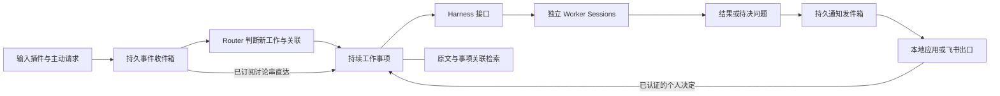

# Work Agent Kernel

一个以**持续工作事项**为中心、可以替换底层 Harness 的个人工作 Agent 架构原型。

输入可以来自别人 @你、个人私聊、文档评论、定时事件，也可以来自你主动提出的请求。Router 判断它属于新事项还是已有事项；Worker 在独立 Session 中推进；需要你决定时，经统一通知出口提出问题，你的决定再回到原事项。

**当前提供离线架构 demo 和可选的真实运行链路。** `demo:*` 保持离线。`src/live` 接入 Responses 模型 Router、Desktop 自带 Codex App Server、常驻总控和发给自己的飞书通知。真实链路需要显式本机配置。项目借鉴 DeepSeek Super-agent 的领域划分，不依赖其 Harness 或 OpenClaw。

真实链路的启动、输入、停止和接入配置见[运行真实最小 demo](docs/LIVE-DEMO.md)。实跑范围和剩余限制见[验证记录](docs/LIVE-VERIFICATION.md)。

## 从一个例子理解

同事在群里问“卡片能否支持加载态”，随后在私聊补充限制，又在文档中更新设计：这应是一件工作，关联多个输入来源，而不是三个互不知情的 Agent。



## 快速验证

使用 Node.js **24.21.0**（CI 在 Linux 和 macOS 使用此版本）。运行时使用 Node 原生 TypeScript 支持和 `node:sqlite`；Zod 是唯一运行时 npm 依赖。

```bash
npm ci --ignore-scripts
npm run check
npm run demo
```

`demo` 创建独立临时目录并打印数据库位置。它真实执行 SQLite 持久化、内核重启和通知落库，模拟来源与 Harness：

1. 接收群聊请求并创建事项。
2. 同一讨论串的补充直接进入原事项。
3. Worker 提出问题，通知写入本地收件箱。
4. 重启内核，接收个人决定。
5. Router 将文档评论关联回原事项。
6. 继续同一模拟 Session，生成草稿结果。
7. 显式换成另一种 Harness，保留事项及结果，创建新的执行 Session。

关键输出应为 `workItems: 1`、`events: 3`、`sameSessionAfterAnswer: true`、`finalStatus: "ready"`。`ready` 表示有待审阅产物，**不表示已经发消息、发布或完成业务验收**。

## 分支迭代的 demo

新增演示通过实际文件和独立 CLI 进程验证输入、决定与执行的连续性。

```bash
npm run demo:replay
npm run demo:decision
npm run demo:loop
```

- `demo:replay` 读取追加式 JSONL，保留修订和补充，重启后继续读取。
- `demo:decision` 通过本地 `answer` 命令回答待决问题，再由新的 CLI 进程继续同一模拟 Session。
- `demo:loop` 组合两条流程，在等待决定时追加输入，之后生成包含范围决定与消息内容的 Markdown 草稿。

每个命令默认创建独立临时目录。输出给出状态和产物路径，便于回查。执行者和 Router 仍是明确标注的测试替身。详见[这轮 demo 的设计和验证](docs/DEMO-ITERATION.md)。

## 已有能力

| 能力 | 原型实现 |
| --- | --- |
| 输入插件 | `Source.fetch(cursor)`；批次与游标一起落库 |
| 主动输入 | `Kernel.ingest(event)`，与外部来源共享事件模型 |
| Router | ResponsesRouter 真实模型分流；ScriptedRouter 仅用于离线测试 |
| 订阅 | 来源讨论串与工作事项多对多；后续输入直达；无关输入可退回 Router |
| 工作流配置 | 版本化 WorkflowProfile：指令、Skill 引用、验收要求，创建事项时固定版本 |
| Harness 替换 | `submit / lookup / poll`；真实 Codex Adapter，事项身份独立于 Session |
| 人工决策 | 持久 Attention；已认证 owner 回答；重复回答幂等 |
| 通知 | 持久 Outbox、LarkOwnerSink 发给配置的本人、SQLite 回执去重 |
| 持久上下文基础 | 原文保留、限长预览、关联 ID 和只读 Recall 接口 |
| 运行可靠性 | 同事项串行、独立事项分别运行、来源故障隔离、未知提交状态不盲重跑 |

## 插件示例

```bash
node src/cli.ts run \
  --plugins ./examples/custom-plugin.ts \
  --db /tmp/work-agent-plugin.sqlite \
  --ticks 2

node src/cli.ts inspect --db /tmp/work-agent-plugin.sqlite
```

插件导出 `createPlugins(): Plugins`，提供 Source、Router、Harness 和 NotificationSink。这里是显式加载可信本地代码，不是沙箱插件市场。命令只运行指定次数，不安装常驻服务。

## 设计与后续推进

- [架构、职责与状态流](docs/ARCHITECTURE.md)
- [插件契约与 JSON 示例](docs/CONTRACTS.md)
- [DeepSeek 原型对照和技术决策](docs/DESIGN-DECISIONS.md)
- [测试与真实接入验收](docs/TESTING.md)
- [分阶段路线图](docs/ROADMAP.md)
- [面向后续开发 Agent 的约定](AGENTS.md)

## 当前限制

- 真实飞书 Source、Claude Code Adapter、飞书决定回调仍未实现。真实 demo 输入来自主动提交的 JSONL。
- SQLite 保存单个 JSON aggregate，适合验证结构与事务，不能直接作为海量飞书归档。
- 一个数据库只由一个 Host 拥有；未提供多进程协调、集群或可抢占调度。
- 真实 demo 验证已完成结果保留、总控退出后自动重启、下一回合续接原线程。不承诺执行中的回合在进程崩溃后无损恢复。
- launchd 监控进程退出。尚无任务语义 Watchdog、运行中 steering 或语义向量记忆；执行记录沿用 Codex 原生线程。
- `scope` 和 `actor` 是 Host 传入的控制信息；生产适配器还必须实现实际认证、权限映射与沙箱。

不会因为开着这个仓库就自动执行未来路线图；后续每个阶段都应依据明确任务和验收推进。
