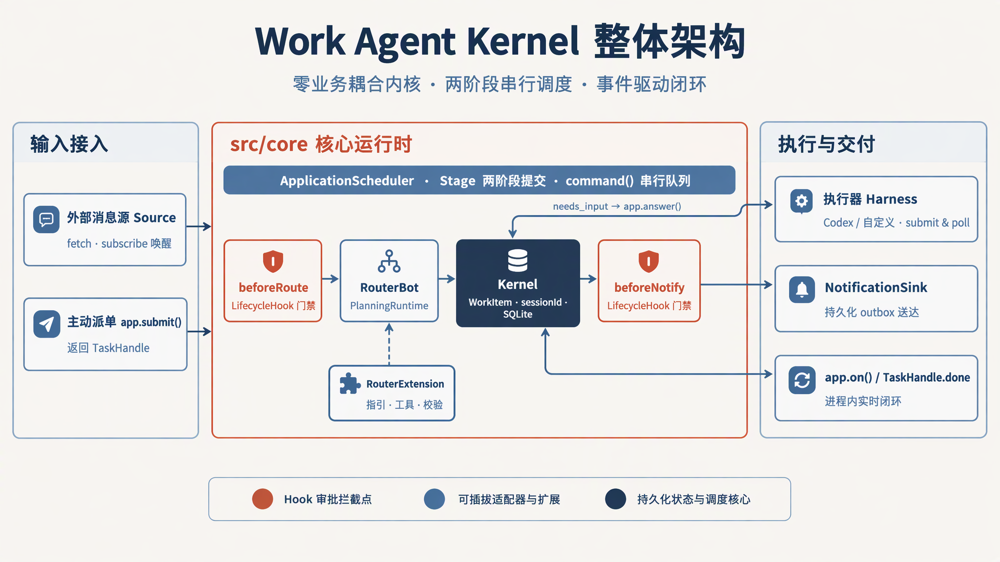

# Work Router

**简体中文** · [English](README.md)

> **一个类型安全、可断电恢复的 TypeScript 任务分发内核（Router Bot Kernel）。**  
> 统一收拢来自外部消息渠道与主动派单的请求，由规划模型决定**新建事项、续接已有会话或直接答复**；内核在事务与边界校验后交由执行器异步完成，并在全流程中支持人工审批挂起、运行中追问恢复与幂等通知投递。

`Node.js >= 24` · `TypeScript` · `ESM` · `SQLite WAL` · `MIT License`

[30 秒上手](#30-秒上手) · [核心架构](#核心架构) · [包入口与扩展接口](#包入口与扩展接口) · [实战示例](#实战示例) · [开发与校验](#开发与校验)

---

## 核心设计保障

把大模型接入真实工作流时，最容易失控的不是模型本身，而是权限越界、上下文断裂与状态丢失。Work Router 在内核层把这些问题收口成确定性的工程契约：

- **分诊与执行强制分离**：**Router（只读规划）** 与 **Harness（实际执行）** 职责彻底解耦。Router 只产出结构化计划，不能直接修改项目文件或对外发消息；同一工作事项保留专属 `sessionId`，后续补充自动续接原会话。
- **防幻觉与越权校验**：`RouterBot` 对规划输出做严格 Schema 校验——引用的每条 `evidenceId` 必须在本轮真实读到过；续接 `workId` 必须先经列表工具检索确认且与所属项目一致；严格受 `maxActions` 与工具调用上限约束。
- **两阶段调度与崩溃可恢复**：`ApplicationScheduler` 通过 `Stage`（`Prepared<T>`）将慢速外部 I/O 与同步状态 `commit()` 拆开，所有写命令经单线串行队列落入 SQLite。即使进程在派发或执行窗口崩溃重启，也可凭 `requestId` 通过 `lookup()` / `poll()` 对账续跑，不重复派单。
- **异步阻塞互不牵连**：无论是路由前的外部审批卡（`beforeRoute` Hook 返回 `wait`），还是执行器中途向人发起选择题（`needs_input`），都只暂停当前事项，其他任务与调度循环照常推进。
- **零平台耦合与编译级边界校验**：`core` 模块没有任何向具体适配器或业务的反向引用，并通过基于 `tsc` 的自动化边界测试保证所有适配器仅单向依赖 `core`。

---

## 30 秒上手

### 1. 在 TypeScript 中接入核心 API

从 `work-router` 创建自驱应用实例，提交任务后即可通过 `TaskHandle` 或事件订阅闭环等待结果，无需外层手写轮询定时器：

```ts
import { mkdirSync } from 'node:fs';
import {
  createRouterApplication,
  type Harness,
  type NotificationSink,
  type PlanningRuntime,
} from 'work-router';

// 1. 定义规划运行时（可接入 Codex、OpenAI Responses 或自定义模型循环）
const runtime: PlanningRuntime = async (_request, _tools, _signal, _instructions) => ({
  answer: '已创建构建排查任务',
  evidence: [],
  actions: [{ goal: '排查今日 CI 构建失败原因', project: null, workId: null, evidence: [] }],
});

// 2. 定义实际执行器与通知出口
const worker: Harness = {
  async submit(req) {
    return { sessionId: 'sess-1', runId: `run-${req.requestId}` };
  },
  async lookup() {
    return null;
  },
  async poll() {
    return { kind: 'ready', summary: '已定位到依赖版本冲突', evidence: ['log://ci/42'] };
  },
};

const inbox: NotificationSink = {
  async deliver(notice) {
    console.log('收到交付通知:', notice.body);
    return `receipt-${notice.id}`;
  },
};

// 3. 确保数据目录存在，装配并启动应用
const directory = './.agent-data';
mkdirSync(directory, { recursive: true });

const controller = new AbortController();
const app = createRouterApplication({
  directory,
  catalog: { defaultHarness: 'worker', projects: [] },
  runtime,
  harnesses: { worker },
  sinks: { inbox },
  signal: controller.signal,
});

// 监听执行器运行中向用户发起的选择题
const off = app.on('work.needs_input', async ({ attention }) => {
  if (attention) {
    await app.answer({
      attentionId: attention.id,
      choice: attention.options[0]!,
      actor: 'local-owner',
    });
  }
});

app.start();

try {
  // 4. 提交任务并等待规划与执行终态
  const task = app.submit({
    id: crypto.randomUUID(),
    description: '排查今日 CI 构建失败原因',
    sources: [],
  });

  const plan = await task.routed;  // 已持久化分单，含 result 与 workIds
  const result = await task.done;  // 本次输入关联的最终执行结果
  console.log(plan.workIds, result.outcomes);
} finally {
  off();
  await app.stop();
  await app.close();
}
```

### 2. 零配置运行离线演示

准备 **Node.js 24**，无需外部账号或 API Key，在仓库根目录运行：

```sh
npm ci --ignore-scripts
npm run build
npm run demo
```

演示将使用临时 SQLite 数据库、模拟消息与受控执行器，完整跑通「收到补充消息 → 续接同一工作事项 → 追问用户后重启内核并提交回答 → 续用原会话 → 显式切换新执行器 `rebind`」：

| 输出字段 | 验证的核心行为 |
| --- | --- |
| `workItems: 1`, `events: 3` | 三条连续输入被合并归入同一个持续推进的工作事项。 |
| `sameSessionAfterAnswer: true` | 用户回答追问并重启恢复后，执行器仍在原会话中继续执行。 |
| `harnessAfterRebind: "echo"` | 最后一步显式切换执行器，保留了完整历史输入与此前结果。 |

---

## 核心架构



### 任务流转与六大原语

1. **输入接入（`Source` / `app.submit()`）**：外部来源通过 `Source` 拉取（`fetch`）或推送唤醒（`subscribe`）入库并按 `[source, externalId, revision]` 去重为 `Event`；主动指令通过 `app.submit()` 写入派单队列并立即返回 `TaskHandle`。
2. **路由前门禁（`beforeRoute` `LifecycleHook`）**：进入 Router 前先过本地规则链。需要外部审批（如陌生群消息确认卡）时返回 `wait` 并保存断点，同时异步投递 `HookEffect`；审批回调经 `app.resume(ticket, resolution)` 恢复后续流转。
3. **规划分诊（`RouterBot` + `RouterExtension`）**：`PlanningRuntime` 结合动态绑定的 `RouterExtension`（按请求注入指引 `instructions`、只读工具 `tools` 与提交前断言 `verify`）输出 `Report`。
4. **核心状态机（`Kernel` & `ApplicationScheduler`）**：所有状态变更统一经 `command()` 串行写入 `Store`。根据规划结果新建 `WorkItem` 或追加到已有事项的 `pendingInputs`，并与源讨论串建立关联。
5. **异步执行与回流（`Harness`）**：`Host` 在并发上限内向执行器 `submit(request)` 获取回执；执行器返回 `ready`、`failed`、`reroute`（退回重新路由）或 `needs_input`（创建 `Attention` 挂起等待 `app.answer()` 后继续同一会话）。
6. **结果交付双通道（`NotificationSink` / `app.on()`）**：`outbox` 经 `beforeNotify` Hook 审核后通过 `NotificationSink` 幂等送达主人；同时进程内界面可通过 `app.on('work.completed' | 'work.failed' | 'work.needs_input')` 与 `TaskHandle` 即时感知结果变化。

> 深入了解运行时契约、状态流转与选型取舍：  
> [Application 运行与等待接口](docs/application.md) · [架构总览](docs/architecture/overview.md) · [统一路由与会话设计](docs/architecture/routing.md) · [架构设计取舍](docs/architecture/decisions.md)

---

## 包入口与扩展接口

### 公共导出路径

项目执行 `npm run build` 后通过 `package.json` `exports` 暴露以下 ESM 与类型声明入口（内部实现文件禁止跨边界直接导入）：

| 导入路径 | 包含内容 |
| --- | --- |
| `work-router` | `createRouterApplication`、`ApplicationStoppedError` 及全部核心契约与领域类型 |
| `work-router/adapters/codex` | `codexPlanner`（Router 规划器）与 `CodexHarness`（Codex App Server 执行器） |
| `work-router/adapters/feishu` | 飞书收件箱 `RouterInbox`、实时聊天与上文读取工具、准入与通知 Hooks |
| `work-router/adapters/responses` | 基于 Responses API 的轻量 `ResponsesRouter` 与策略校验 |
| `work-router/adapters/file` | 基于 JSONL 文件的事件来源 `FileEventSource` |
| `work-router/adapters/local` | 基于本地 SQLite 的通知收件箱 `SqliteInbox` |

### 如何扩展自己的业务

| 我想扩展的能力 | 实现的接口 / 配置项 | 参考文档与实例 |
| --- | --- | --- |
| **接入新消息渠道** | 实现 `Source`（可选实现 `subscribe` 唤醒） | [扩展契约](docs/extensions/contracts.md) |
| **增加审批门禁或通知拦截** | 实现 `LifecycleHook`（`beforeRoute` / `beforeNotify`） | [Hook 状态与回调](docs/extensions/hooks.md) · [飞书准入 Hook](src/adapters/feishu/hooks/admission.ts) |
| **给 Router 注入规则与业务工具** | 编写 `RouterExtension` 传给 `router.extensions` | [扩展示例 release-plan](examples/feishu-codex/release-plan.ts) |
| **替换负责判断的 AI 引擎** | 实现 `PlanningRuntime` 传入 `options.runtime` | [规划接口定义](src/core/planning/contracts.ts) |
| **接入新的 Agent 执行器** | 实现 `Harness`（`submit` / `lookup` / `poll`） | [CodexHarness](src/adapters/codex/harness.ts) |
| **自定义应用装配与运行配置** | 组合 `createRouterApplication(options)` | [飞书 + Codex 配置档案](examples/feishu-codex/profile.ts) |

---

## 实战示例

仓库按“完整应用”与“底层原语”分层提供了多个可运行的示例工程（完整索引见 [examples/README.md](examples/README.md)）：

- **飞书 + Codex 智能工作台（推荐入口）**：[examples/feishu-codex/README.md](examples/feishu-codex/README.md) · [Quick Start](examples/feishu-codex/QUICKSTART.md)  
  完整演示群聊准入卡片、按项目隔离 Codex 工作目录与历史会话、主动派单以及配套的 [Codex Desktop 插件](plugins/router-inbox/README.md)。在支持 MCP App 的 macOS Codex Desktop 环境安装依赖后即可启动：

  ```sh
  npm --prefix plugins/router-inbox ci
  npm --prefix plugins/router-inbox run install:codex
  node examples/feishu-codex/cli.ts serve
  ```

- **Hook 异步挂起与断点恢复**：[examples/lifecycle/demo.ts](examples/lifecycle/demo.ts)  
  演示请求 A 等待外部审批期间，请求 B 正常流转完成，批准后请求 A 带着上下文从断点恢复执行（见 [Hook 等待恢复说明](docs/extensions/hooks.md)）。
- **外部插件端到端闭环**：[examples/primitives/offline-loop/demo.ts](examples/primitives/offline-loop/demo.ts)  
  使用 `FileEventSource` + `SqliteInbox` 演示进程外提交回答后继续生成 Markdown 草稿：

  ```sh
  demo_dir=$(mktemp -d)
  npm run demo:loop -- --directory "$demo_dir"
  ```

- **底层原语与评估**：[底层内核演示](examples/primitives/kernel/demo.ts) · [路由事实与模型评估](examples/router-eval/run.ts)

---

## 开发与校验

在仓库根目录执行以下脚本进行构建与验证（详情见 [测试与验收指南](docs/TESTING.md)）：

```sh
npm run build       # 编译 ESM 与 TypeScript 声明到 dist/
npm run typecheck   # 全量 TypeScript 类型检查
npm test            # 运行单元测试、模块分层依赖防线校验与 npm pack 导出测试
npm run check       # 依次执行 typecheck 与全量 test
```

其中测试套件内建了两项工程防线：
- [module-boundaries.test.ts](test/module-boundaries.test.ts)：调用 `tsc` 校验 `src/core` 与各个适配器之间的单向依赖，禁止跨层与跨适配器耦合。
- [package-exports.test.ts](test/package-exports.test.ts)：在临时目录离线执行 `npm pack` 与 `npm install`，验证所有公开子路径导出可用、类型声明完整、私有文件受阻且不夹带源码或测试文件。

[贡献指南](CONTRIBUTING.md) · [MIT License](LICENSE)
