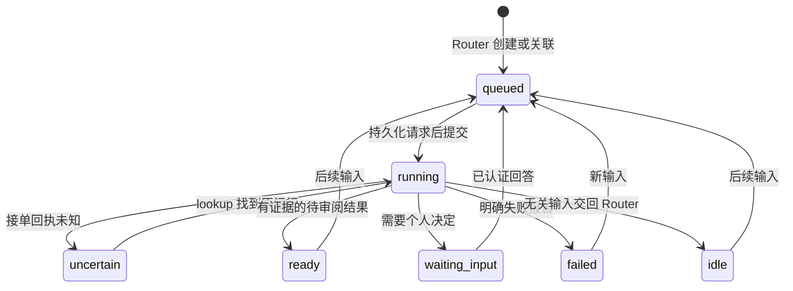

# 原型架构

## 目标与范围

本项目管理跨来源持续推进的个人工作事项。一个事项可以关联多个讨论串，经历多次运行，也可以换 Harness。Session 是执行上下文，不是用户必须手工管理的工作身份。

当前交付包括领域内核、插件契约、持久化模型和可选真实控制服务。离线 demo 使用 ScriptedRouter；`src/live` 使用 ResponsesRouter、CodexHarness 和 LarkOwnerSink。launchd 管理服务进程。真实飞书采集、生产工作流和远端决定回调仍是后续阶段。配置见 [LIVE-DEMO.md](LIVE-DEMO.md)。

## 六个领域对象

| 对象 | 身份与职责 | 与其他对象的关系 |
| --- | --- | --- |
| Event | 来源、外部 ID、修订号共同标识一次事实；记录原文及来源链接 | 属于一个 SourceThread，可投递到多个 WorkItem |
| SourceThread | 来源内部的一段相关讨论；不同来源的 ID 分隔 | 通过 Subscription 与事项建立多对多关系 |
| WorkItem | 目标、授权 scope、固定版本 WorkflowProfile、输入和结果 | 持续存在；拥有多个 Run，当前最多一个活动 Run |
| Run | 一次向 Harness 提交输入的尝试 | 保存 requestId、provider session/run ID 及状态 |
| Attention | 一次明确的待决问题、选项、个人回答 | 归属事项和原始 Run，解答后启动原事项下一轮 |
| OutboxEntry | 发给个人的可投递通知及回执 | 与结果或 Attention 关联；不直接发给来源中的同事 |

Artifact 暂以结果中的证据 URI 表达，没有实现二进制产物仓库。工作知识库与模型长期记忆是独立扩展，不以 Router 的长聊天历史代替。

## 模块与拥有权

| 模块 | 拥有什么 | 不承担什么 |
| --- | --- | --- |
| Source 插件 | 读取、监听或轮询的具体协议，归一化事实 | 判断某条消息是否构成新任务 |
| Kernel | 去重、关联、状态转换、持久化、决策回流 | 调模型、执行 shell、自动发外部消息 |
| Router 插件 | 新建／关联／忽略，选择 Harness 和工作流 | 长时间执行任务或修改业务系统 |
| Harness 插件 | provider Session、运行、结果映射、真实执行权限 | 把私有 Session ID 当成跨 Harness 通用身份 |
| NotificationSink | 向配置好的个人出口投递与去重 | 根据外部消息内容临时扩大收件人范围 |
| Host | 串行推进控制命令、限制活动运行数、收集适配器错误 | 高可用集群、业务分支矩阵 |
| Store | 事务与 schema 版本；保存可重新读取的事实 | 模型语义检索与无限规模归档 |

Source 采用拉取批次的最小接口。未来 WebSocket/Webhook 插件可以将消息缓冲为批次，也可以由已认证的 Host 调用 `ingest`；传输方式不进入 Router。

## 一条真实工作形态的原型流程

1. 群聊插件产生 Event，Kernel 在事务里保存事件和采集游标。
2. 已有订阅时直接加入事项输入；否则由 Router 看摘要、候选事项、工作流目录，必要时通过 Recall 读原文。
3. Router 返回结构化决策。代码验证 schema、事项 ID、scope、工作流存在性后保存。
4. Host 选取 queued 事项。Kernel 先持久化 Run，再调用 Harness.submit。
5. Harness 返回 admission receipt，Kernel 保存 provider Session ID；后续输入继续累积，不创建第二个并发写入者。
6. Host 查询运行结果。`ready` 保存产物引用；`needs_input` 保存 Attention；`failed` 保存失败；`reroute` 把本轮来源输入交回 Router。
7. 通知经 Outbox 投递给 owner。模型原始过程留在 Run／provider 中，不逐 token 推送。
8. owner 在应用或飞书回调中选择选项。Host 完成认证后调用 answer；决定落库并成为下一轮输入，继续同一 Session。

## 工作流与智能判断

WorkflowProfile 是带版本的任务指导，包含 instructions、skills、acceptance。它不是预先编排所有步骤的 DAG。Router 选择 profile；Worker 决定怎么完成任务。Kernel 只传递已经固定的 profile，不修改其业务含义。

程序拥有重复事件判断、已知订阅分发、并发限制和状态转换。模型拥有任务含义、跨渠道关联、执行计划与结果内容。示例没有用关键词分支假装模型。

第一版 `prepare` 只表示准备可审阅成果。`execute` 在类型里预留，但默认不允许；生产 Harness 必须将其映射为实际权限。回答一个业务问题不会扩大 scope。

## 状态流

运行期间到达的补充只入队；本轮结束后 queued，再使用同一 Session。等待人工决定时，普通来源输入不会解除等待。`ready` 不是已发布或已发送；业务交付核实留给以后实现的验收模块。

## Session 与 Harness 替换

同一 WorkItem 的常规后续运行复用当前 Harness 的 sessionId。原型不透明迁移 provider transcript。

显式 rebind 只在当前运行和 Attention 已结清时允许。它保留 WorkItem ID、来源和结果，清空 provider Session，向新 Harness 提供原始输入引用、目标、WorkflowProfile 和近期结果。这是可审计的上下文交接，不宣称两种 Harness 的上下文等价。

Codex、其他 Harness 的 UI、会话持久化和账户登录继续由各自适配器拥有。核心不依赖 Codex Desktop 的内部数据库。

## 持久化与恢复

SQLite 当前存储一个版本化 JSON aggregate；每个状态命令在 `BEGIN IMMEDIATE` 事务内读写。插件网络调用发生在事务之外。所有 reads 都解析 schema 并返回副本。

- 采集批次失败或不合法：不前移游标。
- Router 失败或返回非法决定：事件保持 pending。
- submit 回执丢失：保留同一 requestId，进入 uncertain；只 lookup，不自动新建运行。
- 适配器明确证明尚未提交执行：抛出 SubmissionRejectedError，Run 记录 rejected，事项失败并通知本人，保留未消费输入，释放运行位置。
- lookup 返回 null：表示未知，保持等待。它绝不等价于“没有执行过”。
- provider 仍运行时重启 Kernel：使用保存的回执继续 poll。
- 通知回执丢失：使用同一 notice ID 再投递；避免重复依赖 Sink 的幂等契约。
- owner 在通知发出前已回答：待发问题标记 superseded。

这不是外部副作用的 exactly-once 保证。真实 Harness 若无法查明某次提交，必须保持 uncertain 并进入人工核对，不能因为想恢复就重做发布或发消息。

## 上下文与关联检索

Router 先得到 800 字符预览及最近 20 个事项；Worker 先得到每条输入 1600 字符预览及最近 5 个结果。完整事件保留在 Store，通过只读 Recall 取回。限长值是原型预算，不是业务限制。

这实现 Inline & Spill 的最小形态，没有实现语义检索或自动长期记忆。未来 OpenViking 等模块提供工作资料检索；事件状态、授权、人工决定仍以核心记录为准。

## 明确的部署边界

一个状态库对应一个 Host。适配器必须及时返回或自行超时；Host 不是进程隔离器。source polling 和 Router 判断按顺序推进，provider 实际工作可以在不同 Session 中并行。

原型不实现跨进程调度协调、任务取消、运行中 steering、浏览器租约或任务语义 Watchdog。真实控制服务由 launchd 在退出后重启，但这不代表被中断的任务自动重做。手动回答决定前先停止总控；Desktop 查看和人机接管的边界见真实 demo 文档。
