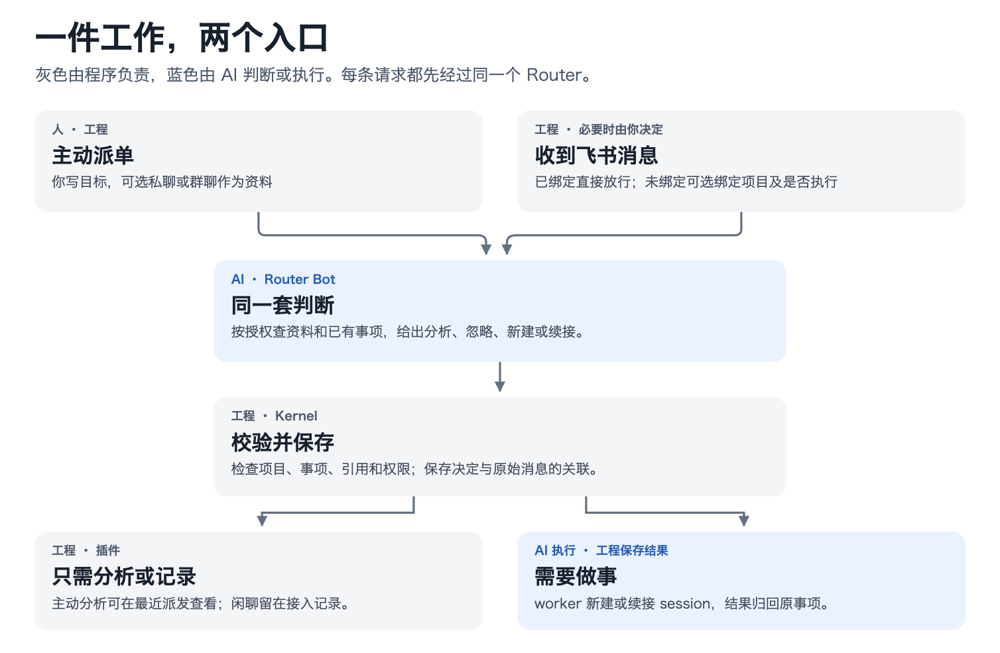

# 一个 Router，两种入口

你在 Desktop 写「给验收清单加一项」，或同事在已绑定的群里发来同样的补充，两条路都会在模型开始判断前进入同一个 Router。系统以持续的工作事项为单位。项目、事项和每次运行的结果都能回查，一件事可以跨多条消息和多次执行。



## 两个入口怎样续接同一件工作

1. 用户在 Desktop 主动派单，要求为演示项目准备验收清单。Router 查找已有事项后建议新建，内核保存项目、工作事项和执行会话的 ID。
2. 已绑定的会话收到「给这份清单加上回滚检查」。飞书适配器提供项目上下文，Router 找到原事项。内核校验续接决定，worker 使用已保存的会话继续工作。

若来信只是「谢谢」，Router 可以结束判断，保留接入记录。若你主动要求「总结这个群最近一天的结论」，Router 可读取所选范围内的资料，在「最近派发」给出答案和引用，全程可以创建零个工作事项。

## 框架拥有什么

| 职责 | 归属 | 可观察的行为 |
| --- | --- | --- |
| 接受本次委托 | 工程 | 两个入口都构造 PlanningRequest，携带目标、来源、资料范围、可选项目和本次允许的行动数 |
| 判断含义 | Router Agent | 按需调用只读工具，提出分析、忽略、新建或续接，输出结构化计划 |
| 校验并记账 | 工程 | 核对计划结构、项目、读过的引用及可续接的事项；内核维护去重、状态、事务和恢复 |
| 完成工作 | Worker | 按目标准备成果；同一执行器续接事项时拿到原 session ID 和近期结果 |
| 通知与展示 | 工程 | 结果存入事项，通知经持久化待投递记录交给配置的出口；Desktop 展示记录、项目、派发历史与会话链接 |

Router 每次处理独立请求，按需多次读资料。长期上下文保存在项目档案、工作事项和 worker 会话中。模型和执行权限分开配置；默认产品装配沿用本机 Codex 的账户、模型、提供商和推理设置，自动工作沿用已有的只读准备范围。

## 能力如何装到框架上

应用从 [createRouterApplication](../../src/core/application.ts) 注册能力。框架面向接口，默认组合位于 [Router 服务](../../src/router/service.ts)。

| 扩展接口 | 本版的实现 | 换一个应用时 |
| --- | --- | --- |
| Source / EventContextAdapter | 飞书收件箱、项目归属、同项目历史 | 可加入新的消息来源，转换为标准事件和上下文 |
| ContextReader | lark-cli 只读访问用户选中的私聊或群聊 | 可换用其他有权限的资料读取器 |
| PlanningRuntime | Codex App Server 驱动 Router 的单次 agent loop | 可替换模型运行时，沿用同一套 Router 指令、工具和计划校验 |
| Harness | Codex worker，在登记的项目目录工作 | 可独立更换执行器；外部 session ID 由对应执行器解释 |
| AdmissionChannel | 飞书机器人发送决定卡、接收提交、更新卡片 | 其他界面可提供同样的绑定和执行选择 |
| NotificationSink | 本机结果收件箱 | 可配置其他结果出口；投递失败可以重试 |

需要在准入时拦住流程，使用有明确返回结果的准入接口。需要在事项完成后通知人，使用已持久化的通知出口。外部事件生产者通过标准消息入口接入，部署环境自行管理传输方式。

业务规则可在两个阶段注册为可中断 Hook。飞书准入、异步投递和上下文恢复见[生命周期 Hook](../extensions/hooks.md)。

## 保留的产品行为

- Desktop 首页按项目组织会话，点击会话即可回到原聊天。主动派单、消息记录和项目管理位于二级入口，具有关联记录的会话可以查看流程。
- 已绑定群直接进入 Router。启用准入策略时，私聊逐条决定是否执行；类型不明的未绑定消息也使用单条决定。对已确认的未绑定群，绑定项目与本次执行互相独立，选择中断后本条不进入模型。
- 一个项目可以登记多个群和多个工作会话。一个稳定的群标识绑定到一个项目。已有会话可以登记为候选，独立需求也可以创建新的事项。
- 主动派单可选择多个聊天，再填写自己的目标。来信使用本条消息和相关项目上下文。沿用已有执行边界，一条来信最多新建或续接一个事项，主动派单可产生多项，当前最多十二项。两者共用计划校验和内核状态转换。
- 事项保存独立的项目 ID，切换执行器后仍属于原项目。旧数据库中有唯一项目映射的历史事项会在启动时补齐归属。
- SQLite 沿用原表与事件标识。重启可继续待处理工作。已经保存计划的主动派单继续提交该计划，避免重复派发。

## 运行与验收

需要 Node.js 24。现有安装直接使用原 Desktop 入口。新机器的服务和项目配置见 [Router 使用说明](../ROUTER.md)，Desktop 插件构建与安装见 [插件说明](../../plugins/router-inbox/README.md)。

```sh
npm ci
npm --prefix plugins/router-inbox ci
npm run check
npm run demo
npm --prefix plugins/router-inbox test
```

[应用级替换与汇合测试](../../test/router-application.test.ts) · [规划接口](../../src/core/planning/contracts.ts) · [统一判断与校验](../../src/core/planning/router.ts)

## Router 怎样记得上次的分配

项目组织相关工作。事项记录一项具体目标和收到的补充，worker 会话保存实际执行的上下文。每次请求启动一个短期 Router，由它决定是否续接。比如群里发来「给上线清单加上回滚步骤」，Router 可以查原消息、确认它上次派给哪个事项，再将补充交给同一事项。若 worker 还在运行，内核排队保存补充，下一轮沿用原会话。

| Router 要回答的问题 | 本轮可调用的工具 |
| --- | --- |
| 哪个项目绑定了这个群？ | `find_projects` 按名称或来源会话查找，完整项目记录可包含群绑定与登记会话 |
| 谁说过这句话，当时是哪一版？ | `find_messages` 按项目、会话、事项、正文、发送人、时间、状态或修订查本地归档 |
| 哪件工作可以接着做？ | `list_work_items` 查看候选及执行状态，`get_work_item` 查看执行会话和近期输入 |
| 这条消息实际触发了什么？ | `trace_routing` 从消息版本或事项查看实际分配、消耗该输入的运行、待决问题和通知状态 |
| 原始数据到底是什么？ | `read_records` 读取带类型的引用。消息的 `view: "raw"` 返回来源提供的原始业务载荷，并区分已保存、未保存和受限 |
| 用户选中的聊天还有什么？ | `read_selected_chat` 在用户选定的聊天和时间范围读取实时资料，长正文可用返回的引用继续读取 |

来源适配器可实现 `archiveRecord`，提供本条修订的原始业务载荷、规范化消息、准入状态和项目归属。内核在同一次事务内保存处置结果和决定，之后查看的 `create`、`attach`、`ignore` 都来自已提交记录。旧记录缺少决定明细时标明 `legacy_partial`，保留已有的结果和理由。

本地消息搜索覆盖本次可见的已处理记录和当前获准的来信。项目查询可以命中接入时的归属或可见的实际分配目标。主动选择聊天后，归档消息也按选中的来源和时间限制。等待准入或已中止的原文不能从关联事项反查。只有 Router 的本次运行挂载这些工具和判断指引。

索引用于定位，完整记录通过引用读取。大记录以 JSON 文本分片，按返回的游标继续读取并顺序拼接即可还原。引用证据时原样复制消息的 `evidenceId`。本地归档与实时读取分别标注来源。

有本机 Codex 登录态时，可运行 `npm run eval:facts`。验收在临时目录投递两条合成来信，在两条之间重启服务，核对事项、worker 会话和结果，再用独立的 Router 查询原始载荷中的随机值。运行会使用当前账户的模型额度。
