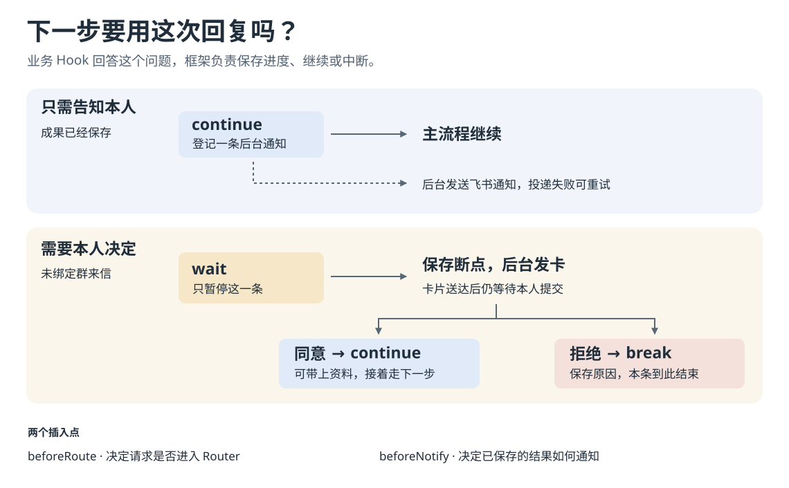

# 业务怎样接一个可中断的 Hook

同样是给飞书发消息，先问一句：**下一步要用对方的答复吗？** 只需告诉本人「成果好了」，就登记发送动作并继续。如果必须知道「这条需求要不要处理」，就保存断点，等本人答复。两种情况都可以异步投递。



## 框架和业务各写什么

框架提供两个时刻。业务按需要注册一个或多个 Hook。每个 Hook 有稳定的名字、所属时刻和一个本地判断函数。程序按注册顺序执行；来源配套的规则先于应用级规则。

| 时刻 | continue | wait | break |
| --- | --- | --- | --- |
| beforeRoute，主动派单和来信进入 Router 前 | 执行下一条规则；全部通过后才调用 Router | 保存当前请求的断点，队列继续处理其他请求 | 保存原因，本次不调用 Router、不创建工作 |
| beforeNotify，工作结果或待答问题已落库，准备投递时 | 下一条规则通过后交给配置的通知出口 | 只暂停本次投递 | 跳过本次投递，保留工作结果 |

**控制决定和外部动作是两个字段。** `kind` 决定何时往下走；可选的 `effect` 描述需要在后台做什么。框架将当前步骤的决定和发件箱记录写入同一个 SQLite 事务。业务的 `run` 做本地判断，外部网络调用放在 `deliver`。同一请求的 Hook 按序执行，其他请求可以在它等待时继续。

## 三种常用写法

| 业务需要 | Hook 返回 | 之后发生什么 |
| --- | --- | --- |
| 本地已找到资料 | `{kind:'continue', context:{version:'v2'}}` | 框架保存该 Hook 的资料，传给后面的规则 |
| 给本人发一条完成通知 | `{kind:'continue', effect:{text:'验收清单已完成'}}` | 下一个步骤可以马上开始，后台单独投递 |
| 必须先问本人或等查询结果 | `{kind:'wait', reason:'等待选择版本', effect:{title:'选择版本'}}` | 保存等待票据，后台发送。收到决定后继续或中断 |

外部查询在一次请求内拿到答案时，`deliver` 可以直接返回 `{kind:'continue',context:{version:'v2'}}`；框架将恢复和投递成功一起提交。交互卡片的发送回执只说明卡片已送达，因此 `deliver` 在发送成功后返回空值。等经过身份校验的回调到达，适配器再调用：

```ts
app.hooks.resume(ticket, {kind:'continue', context:{version:'v2'}});
// 或者
app.hooks.resume(ticket, {kind:'break', reason:'本人取消本次处理'});
```

context 是 JSON 资料，按 Hook ID 分开保存。下一条 Hook 通过 `facts['project.review']` 访问它。在 beforeRoute，资料进入本次 Router 的上下文。在 beforeNotify，资料作为第二个参数交给通知出口。项目授权、可读来源和执行范围仍由框架校验。两个阶段各有自己的上下文。

## 如何让现有服务加载自己的规则

新建一个本地文件 `business-hooks.mjs`，导出 `createHooks()`。下面的例子给进入 Router 的委托附上团队使用的清单版本。

```js
export function createHooks() {
  return [{
    id: 'team.checklist',
    phase: 'beforeRoute',
    run() {
      return {kind:'continue', context:{checklistVersion:'v2'}};
    },
  }];
}
```

给现有服务设置 `ROUTER_HOOKS_FILE` 为该文件的绝对路径，再重启服务。模块以本地服务账号运行，只加载你选择且信任的文件。嵌入框架的应用也可以直接调用 `createRouterApplication({...options, hooks:[...]})`。来源适配器可以用 `ingress` 同时注册自己的 Source、上下文转换和准入规则。

飞书与 Codex 示例显式注册 `feishu.admission`。已绑定群放行；私聊和类型不明的未绑定消息只询问本次是否执行。未绑定群等待本人独立选择「绑定哪个项目」和「本次是否执行」。监听器校验操作者、卡片和选项，保存决定。Hook 的 `readResolution` 读取这个持久化决定，因此重启也能恢复。已发过的待决卡沿用其原回执。完成通知作为可选工厂 `feishuResultNotice(ownerOpenId)` 提供，显式加入 hooks 后才启用。

## 重启、失败和重复提交

- `hooks.sqlite` 保存规则顺序、当前步骤、资料、票据和待发送动作。恢复从未完成的步骤继续。已有断点沿用登记时的规则顺序。
- 相同票据、相同答案可重复提交；通用恢复接口拒绝矛盾的第二个答案。飞书保持已有的首次提交生效语义。业务适配器负责验证回调来源和操作人，票据用于关联等待的步骤。
- 没有答复时保持等待。可以显式提交 `break` 结束该请求。已登记的后台动作有自己的投递记录，流程中断不会撤销先前已经登记的通知。
- 外部投递失败后，后台使用相同动作 ID，30 秒后可重试。调用外部服务时应设置超时并传递幂等键；外部是否重复展示取决于渠道的幂等能力。
- 规则抛错、返回错误结构或缺失时，框架停在该步并记录原因。修复后用 `app.hooks.retry(kind,id)` 从该步重试。`app.hooks.status(kind,id)` 可查看保存的断点，`effectFailures()` 可查看仍在重试的投递。

## 运行一个小例子

在仓库根目录执行：

```sh
node examples/lifecycle/demo.ts
```

第一单询问版本，第二单立即完成。第一单收到 `v2` 后继续，Router 能读到新资料。例子使用临时数据库和本地模拟卡片。本地示例的跨进程验收还覆盖实际服务入口、卡片发送、按钮回调、工作执行和完成通知，两端的外部 CLI 使用受控替身。

[Hook 实现与接口](../../src/core/hooks/lifecycle.ts) · [飞书准入 Hook](../../src/hooks/feishu/admission.ts) · [可运行示例](../../examples/lifecycle/demo.ts) · [行为测试](../../test/hooks.test.ts) · [服务入口测试](../../test/hook-service.test.ts)
